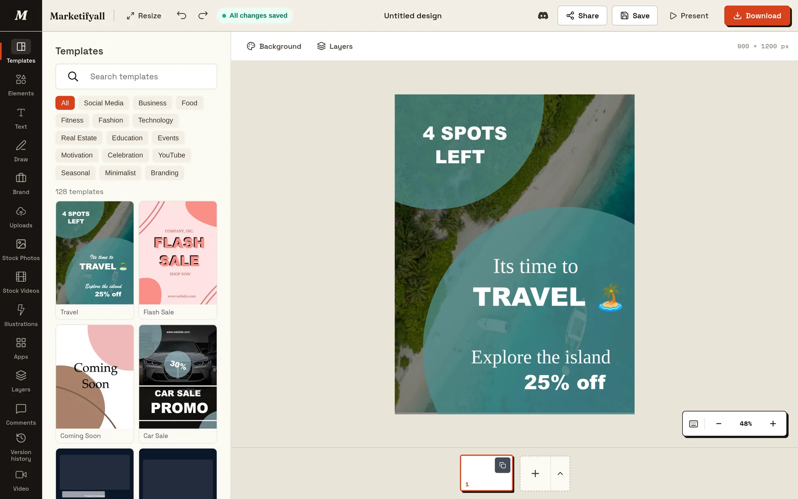
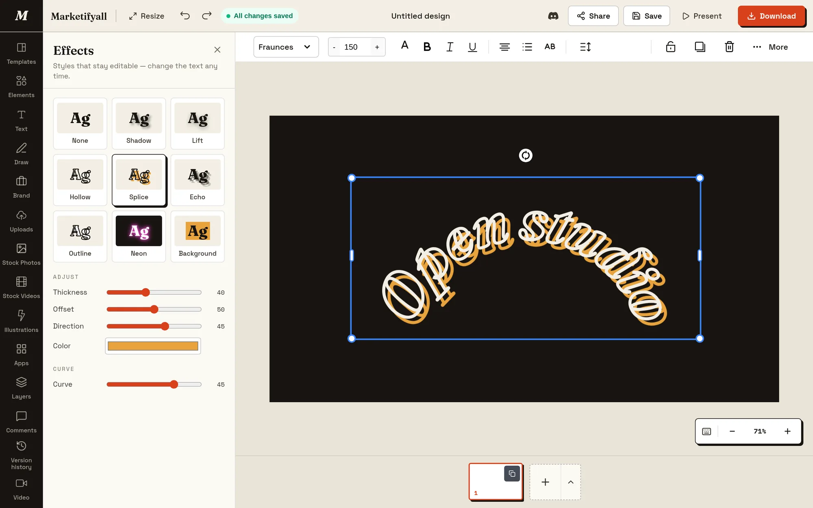
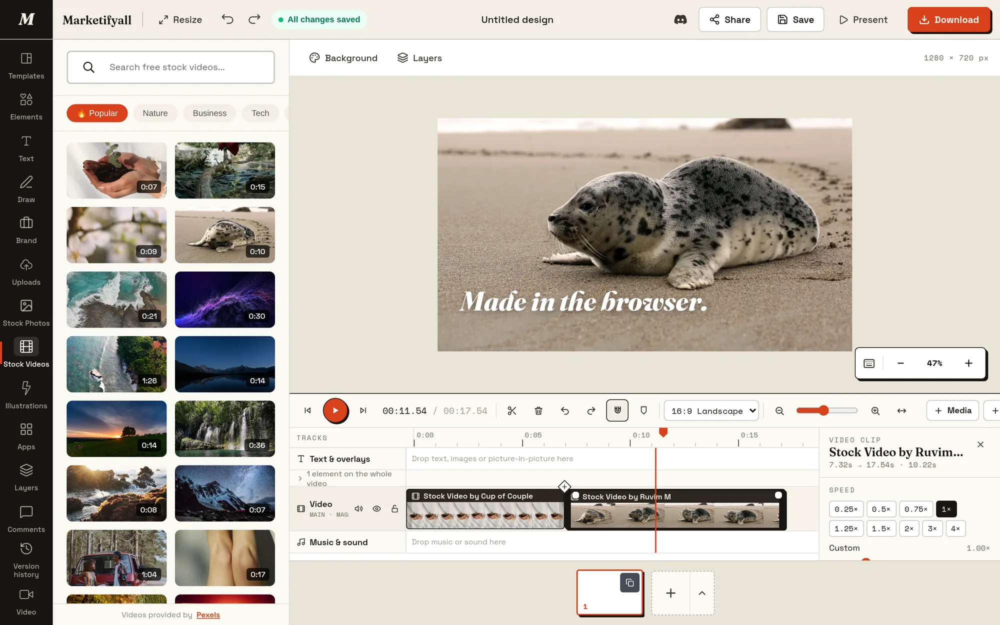
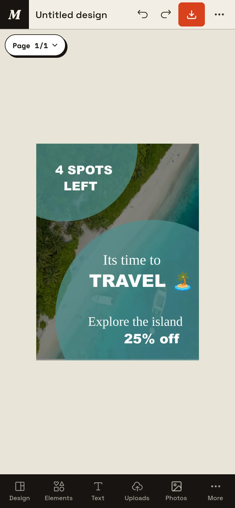

<div align="center">

# Marketifyall Design Editor

**A free, open-source design and video editor that runs in the browser.**
An embeddable Canva alternative with templates, Magic Resize, a Brand Kit, a multi-track video timeline and MP4 export. No watermark, no account.

[](LICENSE)
[](https://github.com/Aadilhassan/Marketifyall-design-Editor/actions/workflows/ci.yml)
[](https://github.com/Aadilhassan/Marketifyall-design-Editor/stargazers)
[](https://discord.gg/mzqYc69hxP)

[**Try the editor**](https://design.marketifyall.com/design?demo=true) ·
[Website](https://design.marketifyall.com/) ·
[Embed docs](https://design.marketifyall.com/developers) ·
[Compare](https://design.marketifyall.com/compare) ·
[Discord](https://discord.gg/mzqYc69hxP)



</div>

## Contents

- [What it is](#what-it-is)
- [Features](#features)
- [Screenshots](#screenshots)
- [How it compares](#how-it-compares)
- [Embed it in your product](#embed-it-in-your-product)
- [Run it locally](#run-it-locally)
- [Configuration](#configuration)
- [Tech stack](#tech-stack)
- [Project structure](#project-structure)
- [Contributing](#contributing)
- [Roadmap](#roadmap)
- [License](#license)

## What it is

Marketifyall Design Editor is a graphic design and video editing app built with React, TypeScript and Fabric.js. Open it in a browser tab and make social posts, posters, presentations, thumbnails and short videos. Start from a template, resize the design for every platform, and export PNG, JPG, SVG, PDF, MP4, WebM or GIF.

- **Free and open source.** MIT licence, every feature unlocked, no watermark on exports.
- **No sign-up to try.** Demo mode keeps your designs in the browser.
- **Private by default.** Video and audio uploads stay in your browser (IndexedDB). Background removal, Magic Eraser and video export run on your device.
- **Embeddable.** Put the whole editor inside your own site or SaaS with one iframe.
- **Works on phones.** The layout switches to a bottom toolbar and touch gestures on small screens.

## Features

| Design | Photos | Video | Finish |
| --- | --- | --- | --- |
| 128 templates | Stock photos and video (Pexels) | Multi-track timeline, magnetic main track | Multi-page designs and Present mode |
| Magic Resize to any size | Background remover (on-device) | Split, trim, snapping (`S`, `J` `K` `L`) | PDF, multi-page |
| Brand Kit: colours, fonts, logos | Magic Eraser (on-device) | 5 transition types | PNG, JPG, SVG up to 4× |
| Text effects and curved text | Photo frames and shadows | Speed 0.25–4× and fades | Transparent PNG |
| Position panel, align, flip | Filters, adjustments, crop | Music and voice tracks, mixed on export | MP4, WebM, GIF up to 4K |
| Rulers and guides (`Shift` `R`) | QR codes (vector) | Animation presets | Version history (auto) |
| Smart guides and layers | Charts (5 types) | Undo/redo across canvas and timeline | Pinned comments |
| Draw: pen and marker | Google Fonts library | Flicker-free, frame-by-frame export | Iframe embed |

Video export renders each frame completely and encodes it in the browser with WebCodecs (H.264) and `mp4-muxer`, so exported videos don't flicker or drop frames. GIFs use a global palette. Browsers without WebCodecs fall back to `MediaRecorder`.

## Screenshots

| Text effects | Video timeline | Phone layout |
| --- | --- | --- |
|  |  |  |

## How it compares

Short version: we give away the tools other editors charge for, and we're open source. They have bigger libraries, AI features and real-time collaboration. Each full write-up includes where the other tool is the better choice.

| | Marketifyall | Canva | Adobe Express | Clipchamp |
| --- | --- | --- | --- | --- |
| Price | Free, every feature | Free + Pro | Free + Premium | Free + Premium |
| Magic Resize / Brand Kit | Free | Pro | Premium | Brand Kit on Premium |
| Graphics and video in one editor | Yes | Yes | Yes | Video only |
| Open source / self-host | Yes (MIT) | No | No | No |
| Embed in your product | One iframe | Partner APIs | Embed SDK | No |

Full comparisons: [Canva](https://design.marketifyall.com/compare/canva-alternative) · [Adobe Express](https://design.marketifyall.com/compare/adobe-express-alternative) · [Clipchamp](https://design.marketifyall.com/compare/clipchamp-alternative) · [Kapwing](https://design.marketifyall.com/compare/kapwing-alternative) · [VistaCreate](https://design.marketifyall.com/compare/vistacreate-alternative) · [Polotno](https://design.marketifyall.com/compare/polotno-alternative) · [Pixlr](https://design.marketifyall.com/compare/pixlr-alternative) · [Photopea](https://design.marketifyall.com/compare/photopea-alternative)

## Embed it in your product

Add the editor with an iframe and talk to it with `postMessage`. There's no SDK to install and no build step.

```html
<iframe
  src="https://design.marketifyall.com/embed?embed=true&callback=true"
  width="100%" height="640"
  allow="clipboard-write; fullscreen"
  style="border:0">
</iframe>
```

```js
const editor = document.querySelector('iframe').contentWindow

// Commands
editor.postMessage({ type: 'marketifyall:load-image', data: { imageUrl: 'https://example.com/photo.jpg' } }, '*')
editor.postMessage({ type: 'marketifyall:set-size', data: { width: 1080, height: 1080 } }, '*')
editor.postMessage({ type: 'marketifyall:export' }, '*')

// Events
window.addEventListener('message', ({ data: msg }) => {
  if (msg?.type === 'marketifyall:design-complete') saveDesign(msg.data.image) // base64 PNG
})
```

Check `event.origin` in production. Full message reference: [design.marketifyall.com/developers](https://design.marketifyall.com/developers).

## Run it locally

You need Node.js 18 or newer (CI uses the version in `.nvmrc`) and Yarn 1.

```bash
git clone https://github.com/Aadilhassan/Marketifyall-design-Editor.git
cd Marketifyall-design-Editor
yarn install          # also applies patches/ via patch-package
yarn start            # http://localhost:3000
```

Open **http://localhost:3000/design?demo=true** to use the editor without a backend or login. Designs are saved to your browser.

| Command | What it does |
| --- | --- |
| `yarn start` | Dev server on port 3000 |
| `yarn build` | Production build in `build/`, pre-rendered with `react-snap` |
| `yarn test` | Jest unit tests (canvas JSON, viewport, video engine, export) |
| `npx tsc --noEmit` | Type-check |
| `yarn format` | Prettier on `src/` |

## Configuration

Everything is optional for local demo use. Copy `.env.example` to `.env` to connect accounts, saved designs and stock media.

| Variable | Used for |
| --- | --- |
| `REACT_APP_SUPABASE_URL`, `REACT_APP_SUPABASE_ANON_KEY` | Sign-in and saved designs (Supabase) |
| `REACT_APP_APP_URL` | Where signed-out users are sent to log in (outside demo mode) |
| `REACT_APP_API_URL` | Backend API (Supabase Edge Functions in `supabase/functions`) |
| `REACT_APP_AUTH_COOKIE_DOMAIN` | Shared auth cookie domain for single sign-on in production |
| `REACT_APP_PEXELS_KEY`, `REACT_APP_PIXABAY_KEY` | Stock photo and video search |

Never commit `.env` files. They are already in `.gitignore`.

## Tech stack

- **App:** React 17, TypeScript, React Router, Redux Toolkit
- **Canvas:** Fabric.js via `@nkyo/scenify-sdk` (patched, see `patches/`)
- **UI:** Base Web + Styletron, with a custom theme in `src/theme`
- **Video:** custom timeline engine in `src/video`, with WebCodecs + `mp4-muxer` for export and `OfflineAudioContext` for the audio mix
- **Storage:** IndexedDB for local media, Supabase for accounts and saved designs
- **Build:** Create React App 4 with CRACO, `react-snap` pre-rendering

## Project structure

```
src/
├── scenes/
│   ├── Editor/          # the design editor (panels, toolbox, timeline, mobile shell)
│   ├── EmbedEditor/     # iframe build of the editor
│   ├── Landing/         # marketing home page
│   ├── Compare/         # comparison articles (/compare)
│   └── Embed/ About/ Features/ Contact/ Projects/
├── video/               # timeline model, playback, rendering
│   └── export/          # MP4 / WebM / GIF encoders and audio mixing
├── hooks/               # canvas enhancements, viewport (zoom/pan), breakpoints
├── utils/               # design JSON migration, resize, image edits, text helpers
├── services/            # API clients
└── theme/               # brand tokens and Base Web theme
packages/                # embed script, CMS SDKs, design-editor-kit
supabase/                # Edge Functions and migrations
```

## Contributing

Bug reports, feature ideas and pull requests are welcome.

1. Fork the repo and create a branch: `git checkout -b feat/your-change`.
2. Make your change and keep `npx tsc --noEmit` and `yarn test` passing.
3. Open a pull request that explains what changed and why. CI runs the type-check, lint, tests and build.

Start with an [issue](https://github.com/Aadilhassan/Marketifyall-design-Editor/issues), or ask in [Discord](https://discord.gg/mzqYc69hxP) if you're unsure where something lives.

## Roadmap

Already shipped: Magic Resize, Brand Kit, background removal, the multi-track video timeline, version history and the mobile layout.

Next up:

- [ ] Real-time collaboration
- [ ] Public share links
- [ ] Multi-page video export (currently exports the current page)
- [ ] AAC audio in MP4 exports
- [ ] Larger template library

## License

[MIT](LICENSE). Use it, fork it, ship it in commercial products.

Built by [QuickShift Labs](https://quickshiftlabs.com/) for [Marketifyall](https://marketifyall.com/). Thanks to [Fabric.js](http://fabricjs.com/), Scenify, [Base Web](https://baseweb.design/), [Pexels](https://www.pexels.com/) and [Google Fonts](https://fonts.google.com/).

<div align="center">

If this project is useful to you, a ⭐ helps other people find it.

</div>
